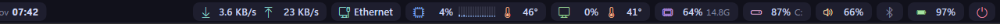
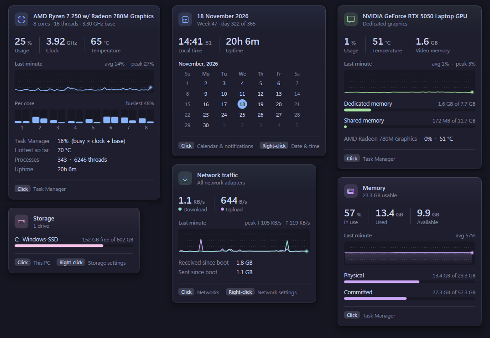

<p align="center"></p>

<h1 align="center">TopBar</h1>

<p align="center"><b>A Waybar-style status bar for Windows 10 and 11 that stays out of your way.</b><br>
Open apps on the left, the clock in the middle, your whole system at a glance on the right.<br>
One native exe under 1 MB. No installer, no admin rights, no drivers, no background services.</p>




## What it shows

| Module | What you see | Click | Other |
|---|---|---|---|
| **Windows** | Icons of your open apps, the active one with its title | Switch to / minimize | Middle-click closes, right-click for a window menu |
| **Clock** | Date and time in your Windows format | Calendar & notifications | Hover for week number, day of year, uptime |
| **Net speed** | Live download / upload | Network flyout | Hover for totals since boot |
| **Network** | Ethernet, Wi-Fi name and signal, or Offline | Network flyout | Hover for adapter, IP, link speed, internet status |
| **CPU** | Usage, tiny per-core bars, temperature | Task Manager | Hover for clock speed, a 1-minute graph and a live bar for every core and thread |
| **GPU** | Usage and temperature (NVIDIA, AMD and Intel) | Task Manager | Hover for VRAM and every other GPU |
| **Memory** | RAM usage % and GB | Task Manager | Hover for available and committed memory |
| **Disk** | System drive usage | This PC | Hover for every drive |
| **Volume** | Level / muted | Mute | Scroll to change, right-click for the mixer |
| **Bluetooth** | On/off, connected device | Bluetooth settings | Hover for all connected devices |
| **Battery** | Charge and charging state (laptops only) | Power settings | Hover for time left |
| **Power** | | Animated power menu | Right-click for a quick list |

Modules that don't apply to your PC (no battery, no Bluetooth, no Wi-Fi) hide themselves.

### Hover for the details

Rest the mouse on a module and a card drops down under it. It keeps updating while it's open, and
moving along the bar glides it from one module to the next.

- **Big numbers first**, then the detail: usage, clock speed, temperature, speeds and sizes at a glance.
- **A one-minute history** for CPU, GPU, memory and network traffic (download and upload on one chart).
- **CPU:** an equalizer with a column for every physical core and a bar for each of its threads.
- **Clock:** this month's calendar with today marked (and ISO week numbers where weeks start on Monday).
- **Meters** for memory, video memory, every drive, volume and battery that turn yellow, then red, as they fill.
- **Hints** at the bottom show what a click, right-click or scroll does.

Each card is tinted with its module's colour, has real rounded corners and a soft shadow, and fades in.
Turning off *Animation effects* in Windows (or `animations = 0`) makes everything appear instantly.



## Power menu

The power menu is a copy of the [wlogout](https://github.com/ArtsyMacaw/wlogout) menu on the Hyprland
setup this bar is modelled on, so switching between Linux and Windows feels the same. Click the power
icon and the screen dims behind six icons. Hover one and it cross-fades to its coloured version while
it springs bigger and its name turns pink. The icons, colours, layout and timing are wlogout's
(`cubic-bezier(.55, 0, .28, 1.682)` over 0.3 s, and a 0.3 s fade in and out like Hyprland's).


- **Lock, Reboot, Shutdown, Logout, Suspend, Hibernate**: one click runs it, as in wlogout.
  Hibernate only shows up when the PC has hibernation turned on.
- **Keys** are wlogout's too: `L` lock, `R` reboot, `S` shutdown, `E` logout, `U` suspend, `H` hibernate.
  Arrow keys or Tab move the focus and Enter picks it. Esc, right-click or a click on the dimmed
  background closes the menu.
- **Suspend on Modern Standby PCs** (most recent laptops) turns the display off, which is how Windows
  itself goes into Modern Standby. The classic sleep call hibernates those PCs instead.

## Bar pet

Right-click the bar and tick **Bar pet**, and a little companion walks back and forth along the empty
part of the bar. Click it and it hops. It's off until you turn it on.

- **Your own GIF:** choose **Choose pet GIF…** (or set `file =` under `[pet]`). Anime girls, Pokémon,
  pixel cats, anything animated. GIFs are mirrored when they walk the other way (`faces = left` if
  yours looks left). Pixel art is enlarged in whole steps so it stays crisp. Bigger pictures are
  scaled down smoothly.
- **No GIF?** The built-in blob hops along in your accent colour (and follows your wallpaper colours).
- It walks in the widest gap (`area = auto`), or only `left` (between your apps and the clock) or
  `right` (between the clock and the stats). It never walks over a module, and hides when there's no room.
- `motion = stay` keeps it in one spot. `pause_on_battery = 1` stops it when unplugged.

It stays cheap: each frame redraws only the few hundred pixels around the pet, never the bar.
The GIF is decoded once into small frames on a background thread. Measured on a 16-thread laptop,
TopBar used the same CPU with the pet walking as without it (about 0.05% of total CPU either way).
The pet stops whenever the bar is hidden, such as when a game is fullscreen.

## Colours from your wallpaper

Tick **Colours from wallpaper** (or set `from_wallpaper = 1` under `[colors]`) and the bar takes its
palette from the desktop picture, like pywal or wallust do for Waybar. Change the wallpaper (or let a
slideshow change it) and the bar fades to the new colours.

- **The background and pills** take the wallpaper's main colour (or its most vivid one, if the main
  colour is greyish like clouds or fog). They keep the same lightness steps as the default palette,
  so everything stays as readable. `wallpaper_tint` (0–100, default 60) sets how strong the tint is.
- **The icons and accents** take the wallpaper's most vivid colours.
- Red, yellow and orange keep their meaning (hot, warning, temperature) whatever the wallpaper.
- The picture is shrunk to 160 pixels and analysed on a background thread, once per wallpaper change.
  Cloud-only files (OneDrive placeholders) are never downloaded for this; Windows' local copy is used.
- Turning it off goes back to the colours in `topbar.ini`.

## Games and movies

TopBar reserves space at the top of each monitor, like the taskbar does, so maximized windows sit
neatly below it. When something goes **fullscreen** on a monitor (a game, a video, a slideshow):

- The bar on that monitor **hides**, and if no bar is visible, TopBar **stops collecting stats entirely**:
  zero work while you play.
- **Watching a video?** Rest the mouse on the very top edge for a moment to peek at the bar, macOS-style.
  It slides away again when you move the mouse off.
- **Playing a game?** Games capture or hide the mouse, so the bar never pops up by accident.
  Press **Ctrl + Alt + B** to peek at it for a few seconds.
- With multiple monitors, only the monitor running fullscreen loses its bar. The other keeps
  showing your CPU/GPU temps while you play.

Outside fullscreen, **Ctrl + Alt + B** hides the bar and gives the screen space back. Press it
again to bring the bar back.

## Light on your PC

- Native C++ with no runtime or framework. About 12–16 MB of RAM.
- About **0.04% of total CPU** on an 8-core laptop while visible, and 0% while hidden.
- Draws in software (Direct2D), so it never touches the GPU your games are using.
- Runs in Windows *efficiency mode* at below-normal priority. Refreshes every second, or every 2 s on battery.
- Expensive readings only run while you're looking at them. For example, CPU clock speed is only read
  while the CPU tooltip is open, and GPU engines that sit idle are checked every few seconds instead of every second.
- Pauses completely when the screen is off or the PC is locked.
- Uses no internet. The network speed is read from your adapters, not from a speed test.
- Animations move a finished picture instead of redrawing it: a card sliding in or gliding to the next
  module costs no drawing at all. Hover fades last 0.14 s and only run while the mouse moves.

## Safe to run

- **No admin rights, no network access, no drivers, no injected code.** It only reads what Windows
  already exposes to your account.
- **DLL loading is locked to System32.** TopBar often sits in Downloads next to other files. It never
  loads a DLL from its own folder (a common way to hijack programs), and it refuses code from network
  shares or browser-downloaded (low-integrity) locations. Old injection points (AppInit DLLs, global
  hooks) are switched off for the process.
- **Pictures are handled carefully.** Pet GIFs must be local files (no network paths, which could leak
  your Windows sign-in to a server), at most 32 MB and 2048×2048, with caps on frames and memory. They
  are decoded by Windows' own image codecs on a low-priority background thread. A file that fails
  any check is explained and the built-in pet is shown instead.
- Built with Control Flow Guard, CET shadow-stack compatibility, ASLR and DEP.

## Works on any PC?

Yes. TopBar is built to adapt rather than assume:

| | |
|---|---|
| **Windows** | Windows 10 and 11, 64-bit. The exe only imports functions that exist since Windows 8.1, and newer features are looked up at runtime. On Windows 10 it falls back to the Windows 10 fonts and icons. |
| **CPU** | Any Intel or AMD CPU. Per-core bars cover up to 64 threads. |
| **GPU** | Any GPU with a modern (WDDM 2) driver: NVIDIA, AMD, Intel, discrete or integrated. Laptops with two GPUs show the dedicated one, and hovering shows both. If the driver doesn't report a temperature, the temperature simply isn't shown. |
| **Sensors** | CPU temperature uses the thermal zone Windows exposes without admin rights. Most laptops have it, and where it's missing the reading hides. |
| **Hardware** | No battery, Bluetooth or Wi-Fi? Those modules hide themselves. Plugging in a dock, a monitor or a Bluetooth adapter is picked up automatically. |
| **Monitors** | One bar per monitor, each sized for that monitor's scaling (100%, 125%, 150%, …). Unplugging or adding a screen rebuilds the bars. |
| **Windows Update** | Uses only documented Windows APIs, with no hooks into Explorer and no injected code. If Explorer restarts (for example after an update), the bar re-registers itself. Kernel GPU statistics are read into padded buffers, so a future Windows build with bigger structures can't corrupt memory. A sensor that stops working just hides. |
| **ARM PCs** | Windows 11 on ARM runs the x64 build through its built-in emulation. |

## Install

1. Download `TopBar.exe` from the [releases page](../../releases) (or build it, see below).
2. Put it in a folder that will stay put (for example `%LOCALAPPDATA%\TopBar`) and run it.

That's it. TopBar **starts with Windows automatically**, so it comes back after restarts and
Windows updates. It uses your account's normal startup list, so no admin rights are needed. If you
move the folder, just run the exe once from the new place and the startup entry follows it.
To turn auto-start off, right-click the bar and untick **Start with Windows** (or set
`start_with_windows = 0`). A switch-off in Task Manager's *Startup apps* page is respected too.

To remove TopBar completely: untick **Start with Windows**, choose **Exit TopBar**, and delete the folder.

## Settings

Right-click the bar and pick **Edit settings…**. This opens `topbar.ini` (created next to the exe,
or in `%APPDATA%\TopBar` if that folder is read-only). Changes apply as soon as you save.

```ini
[bar]
monitors = all                 ; or: primary
height = 30
modules_left = windows
modules_center = clock
modules_right = netspeed, network, cpu, gpu, memory, disk, volume, bluetooth, battery, power
gpu = auto                     ; auto (the dedicated GPU), all, or an index
cpu_usage = time               ; or: taskmanager
interval_ms = 1000

[behavior]
hide_in_fullscreen = 1
reveal_on_hover = 1
peek_hotkey = Ctrl+Alt+B
game_apps =                    ; exe names that should always hide the bar, e.g. game.exe
start_with_windows = 1         ; on by default
animations = 1                 ; hover fades and card motion

[pet]
enabled = 0                    ; off by default
file =                         ; a GIF; empty = the built-in blob
motion = walk                  ; or: stay
speed = 24                     ; pixels per second
area = auto                    ; or: left, right

[colors]
from_wallpaper = 0             ; 1 = take the palette from the wallpaper
wallpaper_tint = 60            ; 0 = grey ... 100 = strongly coloured background
background = #11111b           ; Catppuccin Mocha by default; any #rrggbb works
```

Every option is documented inside the file.

### Command line

```
TopBar.exe --toggle    hide / show the running bar
TopBar.exe --reload    reload settings
TopBar.exe --exit      quit
TopBar.exe --debug     write a timing log to %TEMP%\topbar.log
```

## Notes

- **Why the CPU number differs from Task Manager.** TopBar shows *busy time*: the share of each
  second the cores were actually working. It's a direct measurement with a fixed meaning (0% = idle,
  100% = no idle time left), and it's what Linux, macOS, Process Explorer and Resource Monitor report.
  Since Windows 8, Task Manager instead shows *utility*: busy time multiplied by the current clock speed
  relative to the CPU's base clock. That reads lower when the CPU idles at low clocks and higher when
  it boosts, and it can show 100% while there is still headroom. TopBar shows clock speed as its own
  number and lists Task Manager's reading in the CPU tooltip, so you see both facts separately. Set
  `cpu_usage = taskmanager` if you prefer Task Manager's method. Two tools that sample at different
  moments will always drift by a few percent.
- **CPU temperature** comes from the ACPI thermal zone that Windows exposes without admin rights.
  On most laptops it tracks the CPU package. On some desktops it isn't available, and then it is hidden.
- **Wi-Fi name** needs *Location → Let desktop apps access your location* on Windows 11 24H2 and later.
  Without it, TopBar shows "Wi-Fi".
- **Hybrid-graphics laptops:** while the dedicated GPU is powered down, TopBar doesn't query its
  temperature, so it never keeps the GPU awake.

## Build from source

Requires Visual Studio 2019 or newer with the **Desktop development with C++** workload.

```
build.cmd          :: release build -> build\TopBar.exe
build.cmd debug    :: debug build with symbols
build.cmd test     :: safe test build -> build\test\TopBar.exe
```

Every push is also built by GitHub Actions, and a `v*` tag publishes a release with the exe attached.

The test build (`/DTOPBAR_DRY_RUN`) is safe to play with: the power menu buttons only log their choice
(with `--debug`, to `%TEMP%\topbar.log`) instead of locking, restarting or shutting down, and it
leaves the real install's *Start with Windows* entry alone. It keeps its own `topbar.ini` in
`build\test`. While it runs, `TopBar.exe --snapshot` saves every hover card as a PNG in
`%TEMP%\topbar-snap`, which is how `docs/tooltips.png` is made.

Source layout:

| File | Purpose |
|---|---|
| `src/app.cpp` | Controller: monitors, timers, fullscreen detection, peek, menus, what each card shows |
| `src/bar.cpp` | One bar per monitor: appbar, layout, drawing, mouse, hover fades, drawing the pet |
| `src/tooltip.cpp` | Hover cards: layout, charts, core grid, calendar, rounded corners and shadow, motion |
| `src/pet.cpp` | Bar pet: safe GIF decoding (with frame disposal), the built-in blob, walking |
| `src/wallpaper.cpp` | Colours from the wallpaper: finding the picture, OKLab palette, smooth theme fades |
| `src/stats.cpp` | CPU (busy time, per-core, clock speed), memory, network, GPU (D3DKMT), temperature, disks, battery, Wi-Fi, Bluetooth |
| `src/power.cpp` | Power menu (wlogout layout, CSS-curve hover animations, Hyprland-style fade) |
| `src/audio.cpp` | Default output volume (event driven) |
| `src/winlist.cpp` | Open windows and their icons (including Store apps) |
| `src/render.cpp` | Software Direct2D / DirectWrite renderer |
| `src/config.cpp` | `topbar.ini` loading, defaults and live reload |
| `res/power/` | Power menu icons (embedded in the exe) |

## Credits

The power menu icons are the wlogout icons from [JaKooLit's Hyprland-Dots](https://github.com/JaKooLit/Hyprland-Dots)
(GPL-3.0), unchanged.
