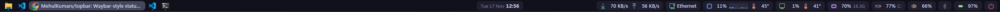

<p align="center"></p>

<h1 align="center">TopBar</h1>

<p align="center"><b>A Waybar-style status bar for Windows 10 and 11 that stays out of your way.</b><br>
Open apps on the left, the clock in the middle, your whole system at a glance on the right.<br>
One 400 KB native exe. No installer, no admin rights, no drivers, no background services.</p>




## What it shows

| Module | What you see | Click | Other |
|---|---|---|---|
| **Windows** | Icons of your open apps, the active one with its title | Switch to / minimize | Middle-click closes, right-click for a window menu |
| **Clock** | Date and time in your Windows format | Calendar & notifications | Hover for week number, day of year, uptime |
| **Net speed** | Live download / upload | Network flyout | Hover for totals since boot |
| **Network** | Ethernet, Wi-Fi name and signal, or Offline | Network flyout | Hover for adapter, IP, link speed, internet status |
| **CPU** | Usage (same numbers as Task Manager), tiny per-core bars, temperature | Task Manager | Hover for clock speed, a 1-minute graph and a live bar for every core and thread |
| **GPU** | Usage and temperature (NVIDIA, AMD and Intel) | Task Manager | Hover for VRAM and every other GPU |
| **Memory** | RAM usage % and GB | Task Manager | Hover for available and committed memory |
| **Disk** | System drive usage | This PC | Hover for every drive |
| **Volume** | Level / muted | Mute | Scroll to change, right-click for the mixer |
| **Bluetooth** | On/off, connected device | Bluetooth settings | Hover for all connected devices |
| **Battery** | Charge and charging state (laptops only) | Power settings | Hover for time left |
| **Power** | | Animated power menu: lock, sleep, hibernate, display off, sign out, restart, shut down | Right-click for a quick list |

Modules that don't apply to your PC (no battery, no Bluetooth, no Wi-Fi) hide themselves.

## Power menu

Click the power icon and the screen dims while big round buttons spring in one after another.
Hover one and it grows and glows (the restart arrow spins, the moon rocks, the power icon pulses).
Lock, Sleep, Hibernate and **Display off** (screen off, PC keeps running) are one click.
**Sign out, Restart and Shut down need a press-and-hold** while a ring fills, so a stray click can
never turn your PC off. Arrow keys + Enter work too, and Esc or a click outside closes it.

## Games and movies

TopBar reserves space at the top of each monitor, like the taskbar does, so maximized windows sit
neatly below it. When something goes **fullscreen** on a monitor (a game, a video, a slideshow):

- The bar on that monitor **hides**, and if no bar is visible, TopBar **stops collecting stats entirely**:
  zero work while you play.
- **Watching a video?** Rest the mouse on the very top edge for a moment to peek at the bar, macOS-style.
  It slides away again when you move the mouse off.
- **Playing a game?** Games capture or hide the mouse, so the bar never pops up by accident.
  Press **Ctrl + Alt + B** to peek at it for a few seconds.
- With multiple monitors, only the monitor running fullscreen loses its bar. The other keeps
  showing your CPU/GPU temps while you play.

Outside fullscreen, **Ctrl + Alt + B** hides the bar and gives the screen space back. Press it
again to bring the bar back.

## Light on your PC

- Native C++ with no runtime or framework. About 12–18 MB of RAM.
- About **0.05% of total CPU** on an 8-core laptop while visible, and 0% while hidden.
- Draws in software (Direct2D), so it never touches the GPU your games are using.
- Runs in Windows *efficiency mode* at below-normal priority. Refreshes every second, or every 2 s on battery.
- Pauses completely when the screen is off or the PC is locked.
- Uses no internet. The network speed is read from your adapters, not from a speed test.
- Uses only documented Windows APIs, with no hooks into Explorer and no injected code. If a sensor isn't
  available it simply hides. If Explorer restarts (for example after a Windows Update), the bar
  re-registers itself automatically.

## Install

1. Download `TopBar.exe` from the [releases page](../../releases) (or build it, see below).
2. Put it in a folder of your choice (for example `%LOCALAPPDATA%\TopBar`) and run it.
3. Right-click an empty part of the bar and tick **Start with Windows**.

To remove it, untick **Start with Windows**, choose **Exit TopBar**, and delete the folder.

## Settings

Right-click the bar and pick **Edit settings…**. This opens `topbar.ini` (created next to the exe,
or in `%APPDATA%\TopBar` if that folder is read-only). Changes apply as soon as you save.

```ini
[bar]
monitors = all                 ; or: primary
height = 30
modules_left = windows
modules_center = clock
modules_right = netspeed, network, cpu, gpu, memory, disk, volume, bluetooth, battery, power
gpu = auto                     ; auto (the dedicated GPU), all, or an index
interval_ms = 1000

[behavior]
hide_in_fullscreen = 1
reveal_on_hover = 1
peek_hotkey = Ctrl+Alt+B
game_apps =                    ; exe names that should always hide the bar, e.g. game.exe

[colors]
background = #11111b           ; Catppuccin Mocha by default; any #rrggbb works
```

Every option is documented inside the file.

### Command line

```
TopBar.exe --toggle    hide / show the running bar
TopBar.exe --reload    reload settings
TopBar.exe --exit      quit
TopBar.exe --debug     write a timing log to %TEMP%\topbar.log
```

## Notes

- **CPU usage** matches Task Manager by default. Since Windows 8, Task Manager shows *utility*:
  busy time scaled by the current clock speed relative to the base clock. So it reads lower than
  busy time when the CPU idles at low clocks and higher when it turbo-boosts. Set
  `cpu_usage = time` for classic busy time (what Linux, Waybar and Resource Monitor show).
  The CPU tooltip always shows both, plus the live clock speed.
- **CPU temperature** comes from the ACPI thermal zone that Windows exposes without admin rights.
  On most laptops it tracks the CPU package. On some desktops it isn't available, and then it is hidden.
- **Wi-Fi name** needs *Location → Let desktop apps access your location* on Windows 11 24H2 and later.
  Without it, TopBar shows "Wi-Fi".
- **Hybrid-graphics laptops:** while the dedicated GPU is powered down, TopBar doesn't query its
  temperature, so it never keeps the GPU awake.

## Build from source

Requires Visual Studio 2019 or newer with the **Desktop development with C++** workload.

```
build.cmd          :: release build -> build\TopBar.exe
build.cmd debug    :: debug build with symbols
```

Source layout:

| File | Purpose |
|---|---|
| `src/app.cpp` | Controller: monitors, timers, fullscreen detection, peek, menus, tooltips text |
| `src/bar.cpp` | One bar per monitor: appbar, layout, drawing, mouse; tooltip popup |
| `src/stats.cpp` | CPU (Task Manager utility + busy time), memory, network, GPU (D3DKMT), temperature, disks, battery, Wi-Fi, Bluetooth |
| `src/power.cpp` | Animated power menu (spring animations, press-and-hold confirm) |
| `src/audio.cpp` | Default output volume (event driven) |
| `src/winlist.cpp` | Open windows and their icons (including Store apps) |
| `src/render.cpp` | Software Direct2D / DirectWrite renderer |
| `src/config.cpp` | `topbar.ini` loading, defaults and live reload |
